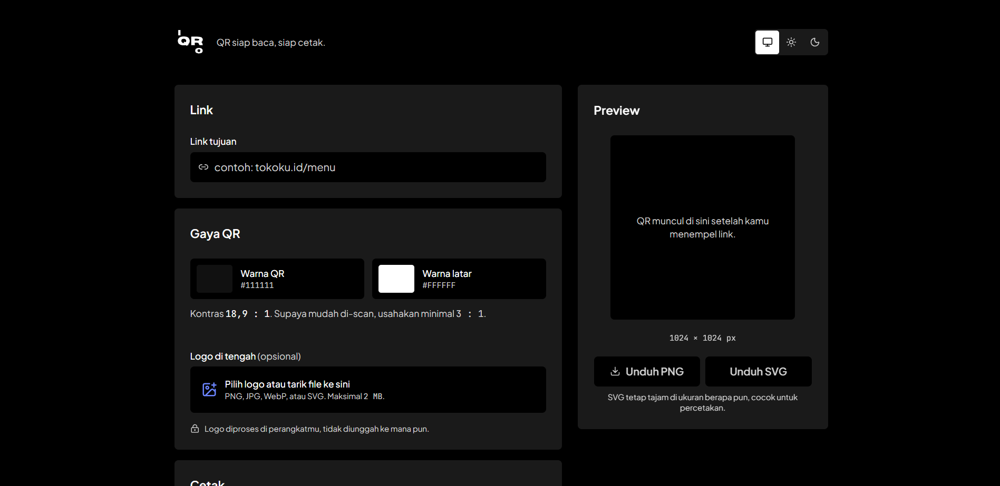

# iQRo — QR siap baca, siap cetak

Buat QR code dari link, dengan logo di tengah dan template siap cetak untuk UMKM. Semua diproses di browser: tidak ada akun, tidak ada server, logo tidak diunggah ke mana pun.



## Fitur

- Link otomatis dirapikan (`tokoku.id` → `https://tokoku.id`); hanya link http/https yang diterima.
- Warna QR dan latar, dengan peringatan kalau kontras terlalu rendah atau QR terbalik.
- Logo di tengah (PNG, JPG, WebP, SVG, maks. 2 MB), ukuran 15–30%.
- 3 template siap cetak 300 DPI: Stiker meja 100×100 mm, Poster A5 148×210 mm, Kartu kecil 90×55 mm.
- Unduh QR saja (PNG 1024 px, SVG) atau template (PNG 300 DPI, PDF ukuran asli).
- Tema terang dan gelap mengikuti pengaturan perangkat.

## Tech stack

- [Next.js](https://nextjs.org) 16 (App Router) + TypeScript
- Tailwind CSS
- [qr-code-styling](https://github.com/kozakdenys/qr-code-styling), [jsPDF](https://github.com/parallax/jsPDF), [lucide-react](https://lucide.dev)
- Font: Plus Jakarta Sans, JetBrains Mono (`next/font/google`)

## Menjalankan di komputer

Butuh [Node.js](https://nodejs.org) versi LTS.

```bash
npm install
npm run dev
```

Buka [http://localhost:3000](http://localhost:3000).

Perintah lain:

```bash
npm run lint    # cek kode
npm run build   # build produksi
```
